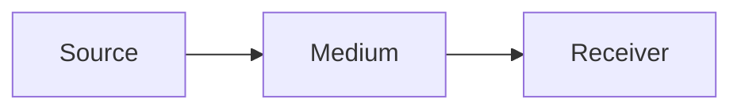
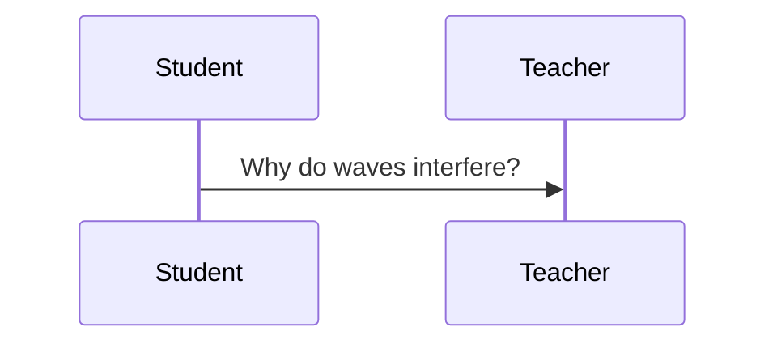

# Chapter 3: Waves

A **wave** carries *energy*, not matter. Its period $T$ and frequency $f$ satisfy $f = 1/T$. See [the notes](https://example.com/waves), ==remember== the key idea, and use `v = f λ` with ~~speed~~ velocity.

The lab kit costs $5, or $10 with the stand.

- Transverse waves
    - Light
- Longitudinal waves

1. Measure the period
2. Compute the frequency

- [ ] Finish problem set 3
- [x] Read chapter 2

> Every wave is a pattern in motion.

$$
\sum_{x=1}^{10} x
$$

Right column: **summary**

- Wavelength λ

$$
\int_0^1 x^2 \, dx
$$

*Handwriting:* wave = period × speed?

Continued from the first page.

